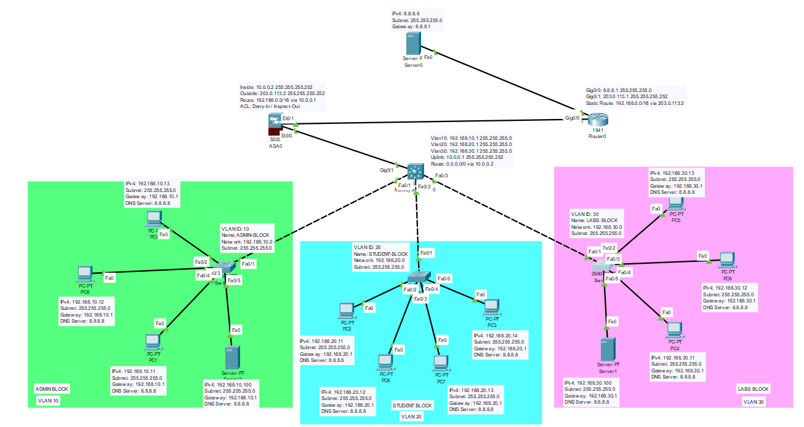
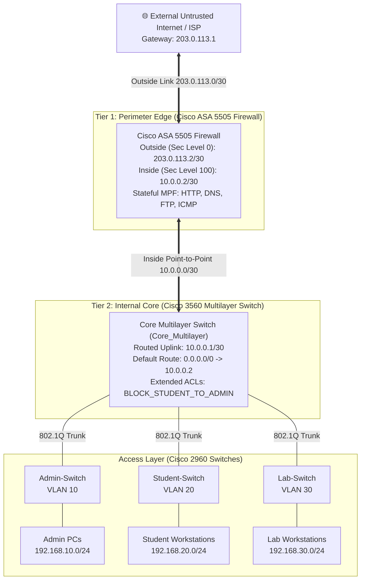

# 🔒 Perimeter Guard: Cisco ASA Firewall Defense

[](https://www.cisco.com/c/en/us/products/security/asa-5500-series-next-generation-firewalls/index.html)
[-orange.svg)]()
[]()
[]()
[]()
[](https://opensource.org/licenses/MIT)

> **Perimeter Guard** is a defense-in-depth network security architecture implemented in **Cisco Packet Tracer**. It combines an enterprise edge **Cisco ASA 5505 Adaptive Security Appliance** with a high-speed **Cisco 3560 Core Multilayer Switch**. The system enforces two-tier security: perimeter-level stateful inspection via the **Modular Policy Framework (MPF)** and internal subnet segregation via directional **Extended Access Control Lists (ACLs)**.

---

## 📌 Table of Contents
- [Architecture Overview](#-architecture-overview)
- [Network Topology Diagram](#-network-topology-diagram)
- [Addressing & Security Zone Matrix](#-addressing--security-zone-matrix)
- [Two-Tier Security Implementation](#-two-tier-security-implementation)
  - [Tier 1: Edge Perimeter Defense (Cisco ASA 5505)](#tier-1-edge-perimeter-defense-cisco-asa-5505)
  - [Tier 2: Internal Segmentation (Core Multilayer Switch)](#tier-2-internal-segmentation-core-multilayer-switch)
- [Security Policy & Verification Scenarios](#-security-policy--verification-scenarios)
- [Repository Structure](#-repository-structure)
- [How to Run in Cisco Packet Tracer](#-how-to-run-in-cisco-packet-tracer)
- [Contributing & License](#-license)

---

## 🏛️ Architecture Overview

In educational and enterprise institutions, administrative networks (housing financial, human resources, and grading systems) require impenetrable isolation from student and lab subnets while preserving unified internet access. 

**Perimeter Guard** solves this through a coordinated **Two-Tier Architecture**:
1. **Edge Perimeter Tier (Cisco ASA 5505)**:
   - Evaluates all ingress and egress boundary traffic.
   - Enforces interface security levels (`inside`: 100 vs. `outside`: 0).
   - Performs stateful protocol inspection (HTTP, DNS, FTP, and ICMP) via the Cisco Modular Policy Framework (MPF).
   - Drops all unsolicited inbound traffic from the untrusted ISP/Internet.
2. **Internal Core Routing Tier (Cisco 3560 Multilayer Switch)**:
   - Provides wire-speed Inter-VLAN routing (SVIs) for internal subnets.
   - Applies directional Extended ACLs on incoming VLAN interfaces to permanently block student and laboratory endpoints from reaching the administrative subnet, while selectively allowing administrative monitoring replies (`icmp echo-reply`).

---

## 🗺️ Network Topology Diagram





---

## 📊 Addressing & Security Zone Matrix

| Device / Interface | Name / Zone | Security Level | IP Address | Subnet Mask | Description |
|---|:---:|:---:|:---:|:---:|---|
| **ASA Ethernet0/1** | `outside` | `0` | `203.0.113.2` | `255.255.255.252` | Untrusted uplink to ISP Edge Gateway |
| **ASA Ethernet0/0** | `inside` | `100` | `10.0.0.2` | `255.255.255.252` | Trusted routed link to Core Switch |
| **Core Switch Gi0/1** | Routed Link | N/A | `10.0.0.1` | `255.255.255.252` | Inter-device transit interface |
| **Core Switch SVI 10** | `VLAN 10` | N/A | `192.168.10.1` | `255.255.255.0` | Administrative Subnet Gateway |
| **Core Switch SVI 20** | `VLAN 20` | N/A | `192.168.20.1` | `255.255.255.0` | Student Subnet Gateway |
| **Core Switch SVI 30** | `VLAN 30` | N/A | `192.168.30.1` | `255.255.255.0` | Academic Laboratories Gateway |

---

## 🛡️ Two-Tier Security Implementation

### Tier 1: Edge Perimeter Defense (Cisco ASA 5505)

#### Security Level Segmentation & Routing
Traffic from higher security levels (`inside` = 100) is permitted to lower levels (`outside` = 0) by default, but unsolicited return traffic is strictly blocked unless verified in the state table:
```cisco
interface Vlan1
 nameif inside
 security-level 100
 ip address 10.0.0.2 255.255.255.252
!
interface Vlan2
 nameif outside
 security-level 0
 ip address 203.0.113.2 255.255.255.252
!
route outside 0.0.0.0 0.0.0.0 203.0.113.1 1
route inside 192.168.0.0 255.255.0.0 10.0.0.1 1
```

#### Modular Policy Framework (MPF) Stateful Inspection
Enforces deep packet inspection and dynamic pinholing for return application sessions:
```cisco
class-map inspection_default
 match default-inspection-traffic
!
policy-map global_policy
 class inspection_default
  inspect dns 
  inspect ftp 
  inspect http 
  inspect icmp 
!
service-policy global_policy global
```
- **ICMP Stateful Inspection**: Allows internal endpoints to ping external servers and receive echo replies while preventing unsolicited ICMP ingress scans.

---

### Tier 2: Internal Segmentation (Core Multilayer Switch)

Extended ACLs on the Core Switch are applied **inbound** on the VLAN interfaces, intercepting packets before routing lookup:
```cisco
ip access-list extended BLOCK_STUDENT_TO_ADMIN
 permit icmp 192.168.20.0 0.0.0.255 192.168.10.0 0.0.0.255 echo-reply
 deny ip 192.168.20.0 0.0.0.255 192.168.10.0 0.0.0.255
 permit ip any any
!
interface Vlan20
 ip address 192.168.20.1 255.255.255.0
 ip access-group BLOCK_STUDENT_TO_ADMIN in
```
- **Line 1 (`permit icmp ... echo-reply`)**: Permits Student endpoints to answer diagnostic ping requests initiated by Administrators.
- **Line 2 (`deny ip ...`)**: Completely drops student-initiated attempts to connect to any service or IP within the Admin subnet.
- **Line 3 (`permit ip any any`)**: Grants uninterrupted access to external cloud/Internet resources and authorized shared servers.

---

## 🧪 Security Policy & Verification Scenarios

| Test Case | Initiating Device | Target Destination | Protocol | Expected Action | Result |
|---|---|---|:---:|:---:|:---:|
| **Admin Outbound** | Admin PC (`192.168.10.2`) | External ISP Server (`203.0.113.1`) | HTTP / ICMP | Forward & Inspect | ✅ **PASS** |
| **Student Outbound**| Student PC (`192.168.20.2`) | External ISP Server (`203.0.113.1`) | HTTP / ICMP | Forward & Inspect | ✅ **PASS** |
| **Admin Audit** | Admin PC (`192.168.10.2`) | Student PC (`192.168.20.2`) | ICMP Echo | Permitted & Echo-Reply allowed | ✅ **PASS** |
| **Student Lateral Attack** | Student PC (`192.168.20.2`) | Admin PC (`192.168.10.2`) | Any IP / TCP / UDP | Blocked by Core Switch ACL | 🛑 **DROPPED** |
| **Lab Lateral Attack** | Lab PC (`192.168.30.2`) | Admin PC (`192.168.10.2`) | Any IP / TCP / UDP | Blocked by Core Switch ACL | 🛑 **DROPPED** |
| **Outside Ingress Probe** | External Attacker | Campus Core (`10.0.0.1`) | Inbound TCP / ICMP | Blocked by ASA Outside ACL | 🛑 **DROPPED** |

---

## 📁 Repository Structure

```
perimeter-guard-asa/
├── assets/
│   └── topology-screenshot.png        # Network topology screenshot
├── configs/
│   ├── cisco-asa-5505.txt             # Cisco ASA 5505 Firewall startup configuration
│   ├── core-multilayer-switch.txt     # Cisco 3560 Core Switch configuration & ACLs
│   ├── admin-switch.txt               # Cisco 2960 Admin Switch access configuration
│   ├── student-switch.txt             # Cisco 2960 Student Switch access configuration
│   └── lab-switch.txt                 # Cisco 2960 Lab Switch access configuration
├── docs/
│   ├── perimeter-guard-final-report.docx # Detailed engineering report & methodology
│   └── open-ended-lab-proposal.docx   # Initial design proposal & requirement matrix
├── packet-tracer/
│   └── perimeter-guard-firewall.pkt   # Interactive Cisco Packet Tracer lab file
├── .gitignore                         # Git ignore rules
└── README.md                          # Comprehensive project documentation
```

---

## 🔌 How to Run in Cisco Packet Tracer

1. Download and install **Cisco Packet Tracer** (v8.0+).
2. Clone this repository:
   ```bash
   git clone https://github.com/jahanzaib-147/Perimeter-Guard-Cisco-ASA-Firewall-Defense.git
   cd perimeter-guard-asa
   ```
3. Open `packet-tracer/perimeter-guard-firewall.pkt`.
4. **Verify Internal Segmentation**:
   - Open Command Prompt on `Student-PC` (`192.168.20.2`) and attempt to ping `Admin-PC` (`192.168.10.2`):
     ```cmd
     ping 192.168.10.2
     ```
     Result: *Destination host unreachable.*
5. **Verify Edge Internet Connectivity**:
   - From `Student-PC`, ping the external gateway:
     ```cmd
     ping 203.0.113.1
     ```
     Result: *Reply from 203.0.113.1 (Stateful inspection verified).*

---

## 📄 License

This project is licensed under the [MIT License](LICENSE).
